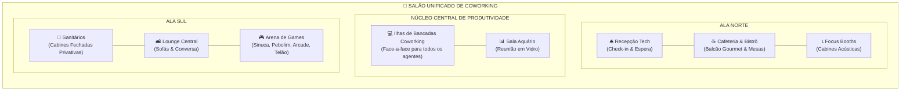

# 🏢 Arquitetura do Coworking Unificado (Aceleradora Tech)

Com base na planta baixa de referência fornecida, este documento define a nova arquitetura do espaço de trabalho integrado, eliminando a divisão em salas de projeto separadas e unificando todo o ambiente em um grande salão contínuo com expansão modular de bancadas de coworking.

---

## 🎨 Imagem de Referência

---

## 🗺️ Zoneamento do Salão Integrado

O espaço não utiliza divisórias fechadas entre as áreas principais, fluindo organicamente em piso de madeira nobre e iluminação quente:

---

## 🧩 Detalhamento das Zonas

### 1. Recepção Tech (Noroeste)
- **Check-in**: Balcão moderno com monitores, fundo ripado de madeira e letreiro tech iluminado.
- **Área de Espera**: Poltronas contemporâneas com mesa de apoio e luminária de chão.
- **Canto de Leitura**: Estante curva de livros com pufe circular.
- **Acesso**: Porta de entrada principal integrada na face oeste.

### 2. Cafeteria Bistrô & Convivência (Norte Central)
- **Bancada Gourmet**: Cafeteiras espresso gourmet, geladeira, micro-ondas e máquina de snacks.
- **Ilha com Banquetas**: Balcão americano com banquetas altas e vitrine iluminada.
- **Mesinhas Bistrô**: Conjunto de mesas redondas para cafés rápidos e reuniões informais.

### 3. Focus Booths & Sala Aquário (Nordeste / Leste)
- **Cabines Acústicas**: 3 a 4 cabines individuais iluminadas para chamadas e foco.
- **Sala de Reunião Aquário**: Sala de conferência 100% envidraçada com esquadrias finas, telão de dados na parede norte e cadeiras executivas.

### 4. Ilhas Centrais de Bancadas de Coworking (O Coração da Aceleradora)
- **Bancadas Compartilhadas**: Ilhas de trabalho face-a-face em madeira clara com monitores duplos de código (telas azuis), teclado e cadeiras pretas ergonômicas.
- **Jardineiras Centrais**: Divisórias baixas de plantas ornamentais entre os módulos de mesas.
- **Expansão Dinâmica**: Os agentes não criam salas fechadas; novas mesas são adicionadas organicamente às ilhas centrais conforme novos agentes entram em ação.

### 5. Lounge & Descompressão (Sul Central)
- **Estar**: Sofá confortável de 3 lugares, poltronas de apoio, mesinha de centro sobre tapete grafite e plantas ornamentais.

### 6. Games & Descompressão (Sudeste)
- **Jogos**: Mesa de sinuca/ping-pong, pebolim, fliperama retrô (arcade).
- **Arena Gamer**: Telão com videogame neon roxo, sofá e pufes coloridos.

### 7. Sanitários Reservados (Sudoeste)
- **Privacidade Total**: Bloco fechado com piso branco/ardósia, bancada de pias com espelhos modernos iluminados e 4 cabines sanitárias com portas cinzas privativas.
