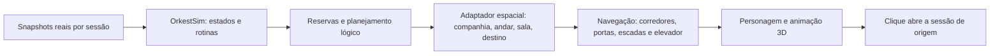

# Adaptação do motor Office para a cidade 3D

## Decisão e estado atual

A simulação existente deve continuar sendo a autoridade de comportamento. Three.js representa o espaço e as animações; não decide se uma sessão trabalha, espera aprovação ou pode passear.

O laboratório já oferece prédios, andares, mesas exclusivas, áreas comuns e um mapa semântico de interação. A ligação do motor completo às coordenadas 3D **ainda não está implementada**. O percurso de entrada atual é uma demonstração local; não comprova equivalência com as rotinas originais.

Fontes examinadas:

- `cockpit/tool/office_world/sim.ts`: `OrkestSim`, snapshots e integração social por sessão.
- `cockpit/third_party/office_engine/client/src/world/sim/sim.ts`: planejamento, reservas, elevadores, máquinas e cabines.
- `cockpit/third_party/office_engine/client/src/world/sim/behavior.ts`: `modeFor`, `pickIdleActivity`, pesos e modos existentes.
- `cockpit/third_party/office_engine/client/src/world/sim/character.ts`: posição, direção, pose, objeto segurado, fila e visibilidade.
- `cockpit/third_party/office_engine/client/src/world/sim/spots.ts`, `path/astar.ts` e `layout/*`: recursos e navegação.

## Contrato de comportamento preservado

| Estado observado | Comportamento que deve continuar vindo do motor |
| --- | --- |
| Harness iniciado, sem turno | Agente presente e ocioso; sem simular trabalho falso |
| working | Trabalho na estação correspondente à sessão |
| waiting | Espera/alerta da própria sessão; sem sair para lazer |
| shell | Espera do comando, com regras existentes de primeiro/segundo plano |
| done de agente principal | Volta ao estado ocioso mantendo presença |
| done de subagente | Entrega/saída conforme a regra original do motor |
| offline / encerramento real | Saída e liberação dos recursos correspondentes |

Presença e trabalho permanecem separados. Não remover o personagem só porque terminou um turno; não propagar espera de um agente para outro. A política de interrupção de ações existentes deve ser preservada quando chegar novo trabalho durante um passeio.

## Responsabilidade de cada camada

`interaction-map.js` já fornece pontos da geometria para esse adaptador. `window.orkestCity.getInteractionMap(companyId)` expõe mesas, recepção, café, cabines, lounge, pingue-pongue, arcade, playground e ligações dos elevadores. Esse método é introspecção do espaço: não contém um segundo sorteador de atividades.

As reservas continuam pertencendo ao motor. Cada mesa tem `agentId` exclusivo; cada assento, máquina e cabine tem um ID estável e capacidade unitária. Recursos públicos do playground têm IDs globais `city:*`, para impedir que empresas diferentes reservem o mesmo lugar como se fossem objetos separados.

## Prédio vertical

O protótipo começa com três níveis físicos:

1. Térreo: recepção, espera, acesso ao elevador e dois banheiros.
2. Primeiro nível: cafeteria, convívio, pingue-pongue e arcade.
3. Primeiro escritório: oito estações.

Nove agentes acrescentam outro piso de trabalho; dezessete acrescentam mais um. As posições dos agentes já existentes são preservadas no plano de alocação. A capacidade de oito por piso e o limite técnico de 64 agentes/empresa são configurações do laboratório, não limites aprovados para o produto.

A cena permite inspecionar todos os níveis. O motor deve usar o mesmo grafo de circulação: mesa → corredor → elevador/escada → área comum → recurso reservado → retorno. A planta lógica 2D atual não pode simplesmente ser esticada em Y: seus caminhos precisam de identificação de nível e portais. A ligação deve evoluir de forma aditiva, preservando os consumidores 2D existentes.

Ao abrir um andar, o renderer oculta os superiores e a fachada que impede a visão; mantém os inferiores e o contexto do prédio. Ao afastar, recompõe o edifício completo. Ocultar um andar é uma decisão de câmera, não uma alteração de presença ou estado do agente.

## Café, banheiro e lazer

O motor original já possui atividades como coffee, water, bathroom, lounge, pingpong, talk, window, shelf, stretch, arcade, snack, mirror e phone. Os pesos existentes devem ser reutilizados junto da disponibilidade dos espaços; não sortear passeios independentemente no renderer.

- **Cafeteria:** reservar máquina/assento, chegar pelo caminho lógico, executar uso e liberar a reserva conforme o motor.
- **Banheiro:** reservar cabine exclusiva, preservar `inside`, `hiddenUntil` e a duração original; ocultar o corpo durante o uso, mantendo a sessão viva.
- **Recepção:** conservar o fluxo de chegada e a identidade, usando o elevador como transporte entre níveis.
- **Convívio:** usar as reservas existentes de assentos e interações sociais.
- **Playground externo:** é um destino novo para agentes de sessão. Exige saída do prédio, caminhada urbana e retorno, além de definir disponibilidade e política de escolha antes de habilitá-lo no sorteio automático. Não confundir os pedestres ambientais já animados com agentes reais usando esse destino.

Também faltam poses 3D específicas para beber, usar máquinas, conversar e jogar. Atualmente existem três poses de caminhada, pose neutra e adaptação sentada. Ter a malha de uma cafeteira não implementa a interação inteira.

## Verificação necessária para ativar no aplicativo

- Consumir os mesmos snapshots de `OrkestSim`, com IDs estáveis, mantendo o renderizador 2D como comparação.
- Validar a projeção de mesas, recursos e filas do motor nas coordenadas de cada andar.
- Exercitar duas sessões independentes, espera de aprovação, retorno de passeio ao trabalhar, banheiro ocupado, reserva disputada e encerramento durante transporte.
- Confirmar crescimento/redução sem duplicar personagens nem perder reservas; andar oculto continua simulado.
- Somente então ligar a WebView 3D aos projetos reais e considerar substituição do Office atual.

Esta etapa entregou a geometria e o contrato espacial testado. O controlador original e as regras do aplicativo permanecem intactos.
